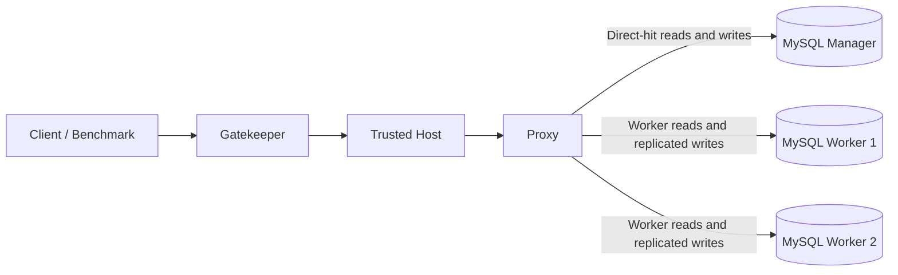

# Distributed MySQL Cluster on AWS — Proxy & Gatekeeper Patterns

A cloud computing project that implements a **distributed MySQL architecture on Amazon EC2**, combining the **Proxy** and **Gatekeeper** design patterns to explore request routing, application-level data replication, network isolation, infrastructure automation, and performance benchmarking.

Developed as an individual final assignment for **LOG8415E — Advanced Concepts of Cloud Computing** at **Polytechnique Montréal** (Fall 2024).

## Project overview

The system uses six Amazon EC2 instances organized into distinct roles: an internet-facing Gatekeeper, a Trusted Host, a Proxy, one MySQL Manager, and two MySQL Workers. Each role exposes a small FastAPI application, while the database nodes run MySQL with the Sakila sample database.

The project demonstrates how to:

- Separate public API access from internal database operations using the Gatekeeper pattern.
- Route read requests through three configurable Proxy strategies.
- Direct writes to a single Manager and replicate successful changes to the Workers at the application layer.
- Provision and configure EC2 instances with Python and Boto3.
- Deploy applications over SSH/SCP and apply AWS security-group restrictions.
- Compare database and end-to-end cluster performance using Sysbench and asynchronous HTTP workloads.

## Architecture



| Component | EC2 instance | Responsibility |
| --- | --- | --- |
| Gatekeeper | `t2.large` | Public entry point; validates requests before forwarding them. |
| Trusted Host | `t2.large` | Intermediary between the Gatekeeper and Proxy, intended to be isolated from direct internet access. |
| Proxy | `t2.large` | Chooses a destination for reads and coordinates writes and replication. |
| MySQL Manager | `t2.micro` | Primary destination for write operations and direct-hit reads. |
| MySQL Workers (2) | `t2.micro` each | Serve worker-routed reads and receive replicated writes. |

### Request flow

**Reads:** A client sends a `GET /read` request to the Gatekeeper with a SQL query and a routing strategy. After validation, the request passes through the Trusted Host to the Proxy, which forwards it to the selected database node.

**Writes:** A client sends a `POST /write` request to the Gatekeeper. The Proxy first executes the write on the Manager; if it succeeds, the Proxy forwards the same operation to both Workers. This is **application-level replication**, not native MySQL replication.

### Proxy routing strategies

| Strategy | Behavior |
| --- | --- |
| `direct_hit` | Send reads directly to the Manager. |
| `random` | Select one of the two Workers at random. |
| `customized` | Ping both Workers and select the one with the lowest observed response time. |

The customized strategy uses **ICMP ping time** as a routing heuristic; it does not measure SQL query execution latency.

## Technology stack

- **Cloud:** AWS EC2, security groups, Boto3
- **Backend:** Python, FastAPI, Uvicorn, HTTP/JSON APIs
- **Database:** MySQL, Sakila sample database
- **Provisioning and deployment:** Boto3, Paramiko, SCP, Bash
- **Networking:** private-network communication design, EC2 security groups, `iptables` configuration scripts
- **Benchmarking:** Sysbench, `asyncio`, `aiohttp`, Faker

## Benchmark results

The following results are taken from the **Fall 2024 assignment report**. They describe a reported experimental run, not guaranteed performance on other AWS instances or configurations.

### End-to-end cluster benchmark

Each routing strategy was tested with **1,000 write requests and 1,000 read requests**, generated asynchronously and sent through the Gatekeeper. The workload used a `users` table and Faker-generated records.

| Read-routing strategy | Total execution time | Successful writes | Successful reads |
| --- | ---: | ---: | ---: |
| Random | **25.05 s** | 1,000 / 1,000 | 1,000 / 1,000 |
| Customized (lowest ping) | 30.70 s | 1,000 / 1,000 | 1,000 / 1,000 |
| Direct hit | 32.73 s | 1,000 / 1,000 | 1,000 / 1,000 |

In this run, **random worker selection was the fastest** of the three approaches, and all reported operations completed successfully. Results can vary with network conditions, instance load, and workload characteristics.

### MySQL Sysbench baseline

The three database instances were also evaluated using Sysbench's read-only OLTP workload:

| Metric | DB instance 1 | DB instance 2 | DB instance 3 |
| --- | ---: | ---: | ---: |
| Transactions per second | 849 | 841 | 848 |
| Average latency | 1.17 ms | 1.19 ms | 1.18 ms |
| 95th-percentile latency | 1.96 ms | 1.96 ms | 1.96 ms |

## Repository structure

```text
.
├── Benchmarking/
│   └── send_simulated_traffic.py   # Asynchronous read/write workload
├── FastAPI Applications/
│   ├── gatekeeper.py               # Public request validation
│   ├── trusted_machine.py          # Request forwarding to Proxy
│   ├── proxy.py                    # Read routing and write replication
│   ├── manager.py                  # Manager database API
│   └── worker.py                   # Worker database API
├── Infrastructure/
│   ├── create_instances.py         # EC2, key pair, security groups
│   └── deploy_files.py             # SSH/SCP deployment and setup
├── constants.py                    # AWS and deployment configuration
├── init.sh                         # Shell entry point
└── run_tp3.py                      # Main orchestration script
```

## Getting started

> **Important:** This is an educational proof of concept that creates billable AWS infrastructure and requires a security review before deployment. See [Security and limitations](#security-and-limitations).

### Prerequisites

- An AWS account with permissions to create and manage EC2 instances, key pairs, and security groups.
- AWS credentials configured locally (the current deployment code reads `~/.aws/credentials`).
- Python 3 and `pip`.
- A Linux environment or Windows Subsystem for Linux (WSL).
- Sufficient EC2 quotas for **three `t2.micro` and three `t2.large` instances**.

The original configuration targets `us-east-1` and uses a hard-coded Ubuntu AMI. Review `REGION`, `ImageId`, key-pair settings, and other values in `constants.py` before launching resources; the original AMI may need to be updated.

### Install and run

```bash
git clone https://github.com/ArthurMilani/LOG8415-TP3.git
cd LOG8415-TP3

python3 -m venv .venv
source .venv/bin/activate
python3 -m pip install boto3 paramiko scp aiohttp faker requests

chmod +x init.sh
./init.sh
```

Alternatively, run the orchestrator directly:

```bash
python3 run_tp3.py
```

The orchestrator creates the infrastructure, transfers the application files, installs dependencies on the instances, updates SSH access rules, and runs the HTTP cluster benchmark. It pauses for Enter at certain stages so the output can be inspected.

**Current-code note:** The repository contains functions for Sysbench execution and `iptables` configuration, but their calls are **commented out in `run_tp3.py`**. Those steps are therefore **not executed by default** in the published version, even though their results and configuration are documented in the assignment report. The current Gatekeeper also has a mismatch between the arguments passed to `read_validations` and its function signature; resolve it before testing the read endpoint or reproducing the benchmark.

### Example read request

Once the deployment is running, the Gatekeeper exposes the API on port `8000`. Replace the placeholder below with its public DNS name:

```bash
curl --get "http://<GATEKEEPER_PUBLIC_DNS>:8000/read" \
  --data-urlencode "method=random" \
  --data-urlencode "query=SELECT * FROM film LIMIT 5"
```

Available read strategies are `direct_hit`, `random`, and `customized`. The `POST /write` endpoint accepts a JSON body containing a `query` field. The included benchmark generates write requests automatically.

After experimenting, **terminate the EC2 instances and clean up associated AWS resources** to avoid unnecessary charges.

## Security and limitations

This project explores security and distributed-systems patterns in an academic environment; it is **not production-ready**.

- The Gatekeeper implements command allowlists and pattern-based checks, but these are **not a substitute for parameterized queries, robust authentication, and authorization**.
- Replication is coordinated by the Proxy after a successful Manager write; there is no distributed transaction or native MySQL replication mechanism.
- The original deployment process uses SSH and copies local AWS credentials to selected EC2 instances. For a production system, prefer **IAM roles**, least-privilege permissions, and more secure deployment practices.
- Review all security-group and firewall rules before use. The repository includes additional `iptables` logic, but the current orchestrator does not enable it by default.
- **Never commit private keys, AWS credentials, or other secrets to version control.** Revoke any keys that have already been exposed and remove them from repository history.

## Academic context

Developed by **Arthur Milani Giovanini** as the individual final assignment for **LOG8415E — Advanced Concepts of Cloud Computing**, **Polytechnique Montréal**, Fall 2024.

The project was built to demonstrate practical understanding of cloud design patterns, distributed database access, infrastructure automation, and benchmark-driven architectural evaluation.
